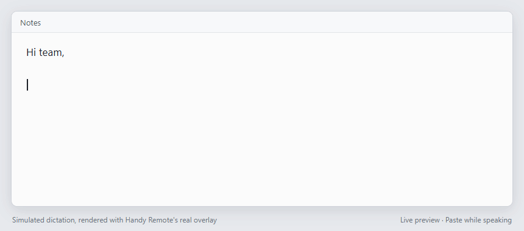
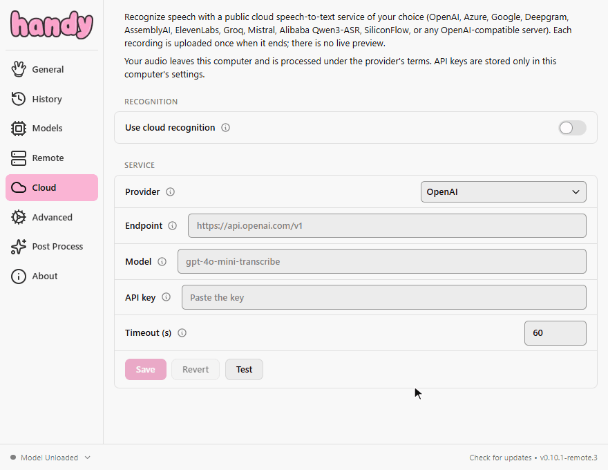
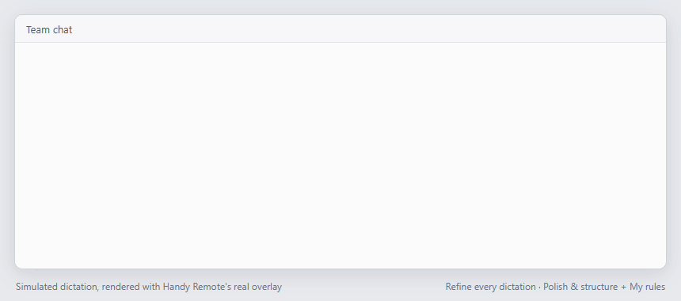
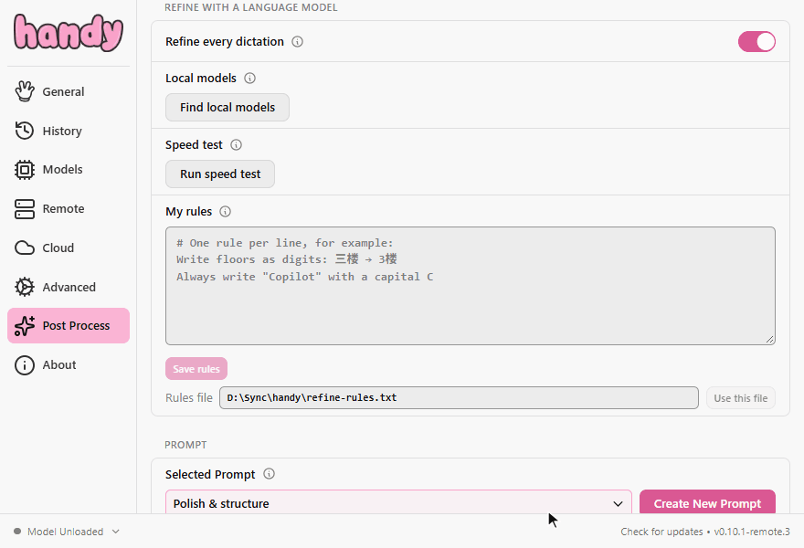

# Handy Remote

[English](README.md) | 简体中文

**把 Handy 的语音识别交给另一台电脑或云端。** 在轻薄本上（或远程桌面里）听写，由局域网里更强的电脑通过
SSH 识别，或交给你选的云端语音服务识别，文字直接上屏到光标处。

  

Handy Remote 是 CJ Pais 开发的 [Handy](https://github.com/cjpais/Handy)（MIT 许可）的分支，保留
Handy 的全部功能；只用一台电脑时，用起来和 Handy 一样。远程相关功能在 Windows 上开发和测试。

## 新增功能

| 功能                                  | 说明                                                                                                                                                                                                                                                                                                                                    |
| ------------------------------------- | --------------------------------------------------------------------------------------------------------------------------------------------------------------------------------------------------------------------------------------------------------------------------------------------------------------------------------------- |
| **通过 SSH 远程识别**                 | 音频经 `ssh -W` 转发，[服务端](server)只监听本机回环地址（仅密钥登录，固定主机密钥）。OpenVINO Qwen3-ASR 1.7B 在配置的 CPU 或受支持的加速设备上识别；可选的 0.6B NPU 模型负责实时预览和推测解码。                                                                                                                                       |
| **实时听写**                          | 说话时实时预览当前句子，边说边逐句上屏；悬浮窗跟随文字光标（[远程桌面里也可以](docs/remote/RDP.md)）；麦克风真正开始收音后才显示就绪提示。                                                                                                                                                                                              |
| **远程设置页**                        | 粘贴配对码、测试连接、生成密钥。                                                                                                                                                                                                                                                                                                        |
| **[云端语音识别](#云端语音识别)**     | 不需要第二台电脑：OpenAI、Azure、Google、Deepgram、AssemblyAI、ElevenLabs、Groq、Mistral、阿里 Qwen3-ASR、硅基流动，或任何兼容 OpenAI 的服务。                                                                                                                                                                                          |
| **[上屏前用大模型润色](#上屏前润色)** | “Polish & structure”提示词会把口述的“第一点…第二点…”整理成编号列表；自动发现本地模型服务（Ollama、LM Studio、llama.cpp、Foundry Local、OVMS、Lemonade），也可以通过 [Copilot bridge](tools/copilot-bridge/README.md) 使用你的 GitHub Copilot 订阅；自带测速；**我的规则**是一个纯文本规则文件，每次听写都会读取。自定义词汇按原样保留。 |
| **反馈闭环**                          | 标记识别错误的听写，在托盘里查看修正建议（[文档](docs/remote/zh-CN/FEEDBACK.md)）。                                                                                                                                                                                                                                                     |
| **独立的应用身份和更新**              | 与原版 Handy 并存安装，首次运行复制（不移动）其设置，从本仓库的签名版本自动更新。                                                                                                                                                                                                                                                       |

### 云端语音识别

没有第二台电脑？打开云端识别，选择服务商，粘贴 API 密钥，点 **Test** 即可。每段录音在结束时上传一次，密钥只保存在本机设置中（[文档](docs/remote/zh-CN/CLOUD-AND-LLM.md)）。

  

### 上屏前润色

把要点口述出来，大模型会按你的规则整理成列表再上屏。

  

  

动图由应用真实的 React 界面配合模拟数据录制；听写场景是用应用真实的悬浮窗模拟的。重新生成方法见
[tools/readme-gifs](tools/readme-gifs/README.md)。

## 快速开始

1. **服务端**（性能更强的电脑）：[docs/remote/zh-CN/SERVER-SETUP.md](docs/remote/zh-CN/SERVER-SETUP.md)。只用云端识别可跳过这一步。
2. **客户端**（你听写用的电脑）：从 [Releases](https://github.com/MusingZone/handy-remote/releases) 下载安装，然后按
   [docs/remote/zh-CN/CLIENT-SETUP.md](docs/remote/zh-CN/CLIENT-SETUP.md) 配置（或在 设置 → Cloud 中开启
   [云端识别](docs/remote/zh-CN/CLOUD-AND-LLM.md)）
3. **其他文档：** [docs/remote/zh-CN/README.md](docs/remote/zh-CN/README.md)

> [!NOTE]
> 安装包**没有代码签名**。如果 Windows SmartScreen 弹出警告，请点 **更多信息 → 仍要运行**。更新包用本项目自己的签名校验。

## 更多

- 与上游的差异：[CHANGES-FROM-UPSTREAM.md](CHANGES-FROM-UPSTREAM.md)（英文）
- 许可：[LICENSE](LICENSE)（MIT）、[THIRD-PARTY-NOTICES.md](THIRD-PARTY-NOTICES.md)
- 安全：[SECURITY.md](SECURITY.md)
- Handy 本身的功能、快捷键和模型说明见英文 README 的[上游 Handy 部分](README.md#upstream-handy-readme)，或
  [Handy 原仓库](https://github.com/cjpais/Handy)。
- 致谢：本项目基于 CJ Pais 及贡献者开发的 [Handy](https://github.com/cjpais/Handy)。
